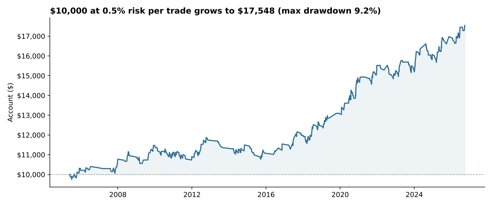
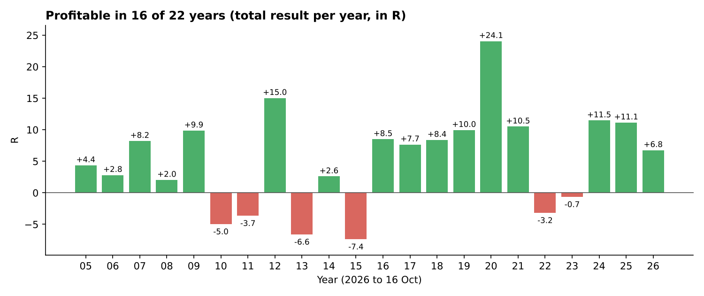

# GBPJPY Rejection & Retest System

A rules-based, fully reproducible version of my discretionary GBPJPY trading style, backtested on 21 years of real OANDA 15-minute prices with costs included.

**Result:** +0.21R per trade over 555 trades (Jan 2005 – Oct 2026). At a fixed 0.5% risk per trade, that is about **+2.7% a year with a 9.2% maximum drawdown**, profitable in 16 of 22 years. The edge is modest and comes mainly from one setup, the daily rejection of a well-tested support or resistance zone (+0.36R per trade). The next stage is a 2–3 month automated forward test on a demo account, with the rules unchanged.





## Trading rules

| Element | Rule |
| --- | --- |
| Zone | A horizontal level touched at least 3 times in the past year, drawn from daily candle opens and closes (not wicks). Zone = level ± 0.3 daily ATR, about ±40 pips |
| Rejection setup | The daily candle trades through the level but closes back on the original side, with a wick at least 1/3 of the day's range. On the 15-minute chart, wait for a higher high (lower low for sells) near the zone, then place a limit order at the broken 15-minute swing |
| Break & retest setup | A daily close beyond the far edge of the zone; a limit order waits back at the level for the retest |
| Stop | 0.41 daily ATR from entry, about 55 pips at GBPJPY's typical 133-pip daily range |
| Target | The nearest daily level giving at least 3R and no more than 4 daily ATR away. Otherwise the trade is skipped |
| Management | Stop moves to breakeven once, at +1.2R; never trailed. Orders wait up to 5 trading days. 20-day time stop |
| Risk | Fixed 0.5% of equity per trade. Loss limits: 2% a day, 5% a week, 10% a month |

Signals are read only after the daily candle closes (22:00 UTC).

## Results

| Period | Trades | Hit target | Avg per trade | Total |
| --- | --- | --- | --- | --- |
| 2005–2014 | 242 | 17% | +0.12R | +29.7R |
| 2015 – Mar 2022 | 181 | 22% | +0.34R | +60.7R |
| Mar 2022 – Oct 2026 | 132 | 20% | +0.20R | +26.5R |
| **All** | **555** | **19%** | **+0.21R** | **+116.9R** |
| Rejection setup | 281 | 23% | +0.36R | +101.4R |
| Break & retest setup | 274 | 15% | +0.06R | +15.5R |

R = profit or loss as a multiple of the amount risked, after costs. About 2 trades a month; worst month −2.5%.

## Method

- **Data:** 548,216 GBPJPY 15-minute candles (OANDA mid prices), 2 Jan 2005 – 16 Oct 2026, from an OANDA practice account via the v20 API. Daily, 4-hour and 1-hour bars are built from them.
- **No look-ahead:** each decision uses only candles that had closed at that moment.
- **Costs:** 3-pip spread on every trade plus extra slippage on stop exits.
- **Conservative fills:** if the stop and target fall inside the same 15-minute bar, the trade counts as a loss.

## What was tested and rejected

Generic support/resistance rules lost money across 14 markets (−0.08R per trade), and a tight 30-pip limit-order version did worse (−0.21R). The edge appeared only once the code matched how I read charts: zones from candle closes, a daily rejection or break, and a 15-minute trigger.

Ten further changes were chosen on 2005–2016 and checked once on 2017–2026. Every change that improved the earlier years did worse than the final rules afterwards, so the rules were kept unchanged ([improvement_tests.csv](results/improvement_tests.csv)).

| Change | 2005–2016 | 2017–2026 |
| --- | --- | --- |
| Final rules (kept) | +0.11R | +0.31R |
| Rejection setup only | +0.31R | +0.12R |
| Rejection only, no breakeven move | +0.45R | +0.05R |
| Plus 50-day trend filter | +0.62R | −0.01R |
| Machine-learning filter (logistic regression) | −0.09R | not tested further |

## Limitations

- No untouched test period remains: drawing levels from closes was decided after seeing 2022–2026, even though it reflects how I trade.
- Results are sensitive to small rule changes (a 68-pip stop turned 2022–2026 negative). A realistic expectation is closer to +0.1R per trade.
- One market and about 2 trades a month; 49% of trades end in a full 1R loss, so long losing streaks are normal.
- Weekend gaps and news can fill stops beyond their price. The news filter is untested because no historical news calendar was available.
- Not yet tested live.

## Run it yourself

```bash
pip install -r requirements.txt
export OANDA_TOKEN="your-practice-account-token"   # never commit this
python src/oanda_download.py GBP_JPY                # writes GBP_JPY_M15.csv
mkdir -p data && mv GBP_JPY_M15.csv data/
python src/prepare_data.py data/GBP_JPY_M15.csv
python src/run_backtest.py                          # writes results/trades.csv and results/summary.json
python src/make_charts.py                           # redraws the charts in docs/
```

| File | Contents |
| --- | --- |
| `src/solomon_setup.py` | Zone detection, both setups, entries, stops and targets |
| `src/strategy.py` | Market specs, bar handling, swing points and the trade simulator |
| `src/portfolio.py` | Fixed 0.5% risk, open-risk cap and loss limits |
| `results/trades.csv` | All 555 trades |
| `results/GBPJPY_Backtest_Results.xlsx` | Results workbook: summary, by year and month, every trade, improvement tests |

Price data is not included; download it with your own OANDA practice account.

## Acknowledgements

This project began as a planned collaboration among researchers from computer science, economics, finance and mathematics under the supervision of Prof. Hasan Arslan at Suffolk University. Prof. Arslan laid much of its foundation, shared his knowledge generously, and encouraged me to carry it forward on my own. I also thank my friend Leon, an early collaborator whose ideas shaped the project before other commitments took him in a different direction.

*Backtest results are hypothetical and do not guarantee future performance. This is research, not investment advice.*
